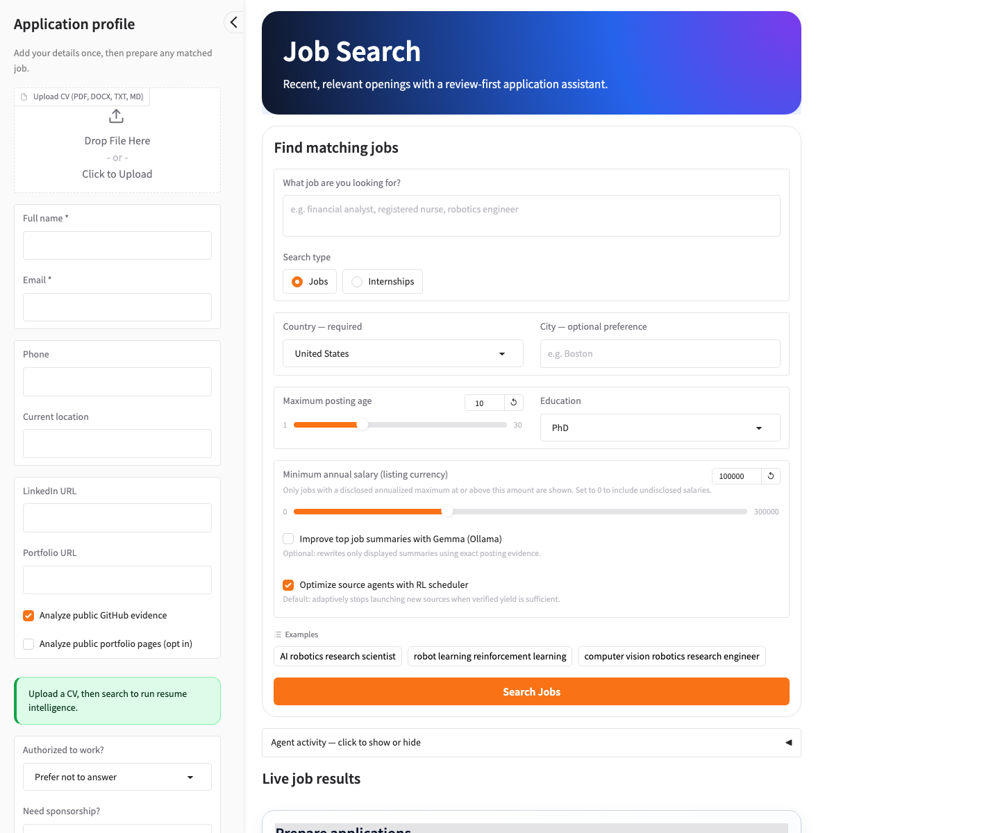
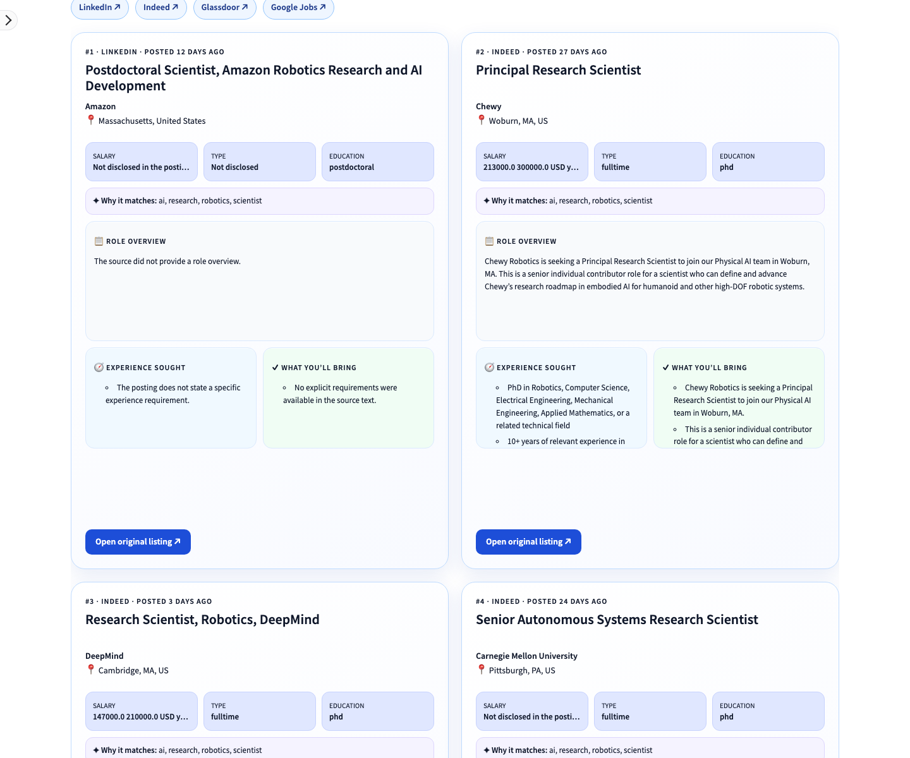

# Job Search

A privacy-conscious, resume-personalized job discovery and application-preparation system. It retrieves recent public listings, enforces user constraints, ranks eligible jobs with classical and neural information retrieval, produces evidence-validated summaries, and keeps final application submission under human control.

## Screenshots

### Main search page

The Gradio landing page combines optional applicant details with the job query, location, posting-age, education, salary, summary, and source-scheduling controls.

<p align="center">
  <a href="assets/job-search-main-page.png">
    
  </a>
</p>

<p align="center"><em>Main Gradio interface before a search. Click the screenshot to open it at full resolution.</em></p>

### Gradio job results

The primary dashboard presents verified live openings as ranked, evidence-rich job cards. This live example searched for **AI robotics research scientist** with a 30-day posting window and returned 20 matches from public job sources.

<p align="center">
  <a href="assets/job-search-results.png">
    
  </a>
</p>

<p align="center"><em>Ranked Gradio results with source, posting age, salary, education evidence, role overview, experience, requirements, and original-listing links. Click the screenshot to open it at full resolution.</em></p>

<p align="center">
  <a href="#tab-1--clone--run"><strong>▶ Tab 1 · Clone & Run</strong></a>
  &nbsp;&nbsp;|&nbsp;&nbsp;
  <a href="technical_report.md"><strong>▤ Tab 2 · Technical Report</strong></a>
</p>

> GitHub README files cannot run JavaScript, so these GitHub-compatible links act as two tabs: the first jumps to setup below and the second opens the complete technical report.

---

## Tab 1 · Clone & Run

### Requirements

- Python 3.11 or newer
- Git
- Internet access for live public job sources
- macOS or Linux for the included Bash launcher
- Optional: [Ollama](https://ollama.com/) for local Gemma summaries

No paid LLM API key is required. BM25 is installed by default. Semantic retrieval and Gemma summaries are optional.

### 1. Clone the repository

```bash
git clone https://github.com/gaudelbijay/jobSearch.git
cd jobSearch
```

### 2. Create the environment

```bash
python3 -m venv .venv
source .venv/bin/activate
python -m pip install --upgrade pip
python -m pip install -r requirements.txt
```

The launcher also creates `.venv` and installs the base requirements automatically when the environment does not exist.

### 3. Launch a dashboard

Gradio is the primary interface:

```bash
./run.sh gradio
```

Open the URL printed in the terminal, normally `http://127.0.0.1:7864`.

Streamlit is also supported:

```bash
./run.sh streamlit
```

Open the printed URL, normally `http://localhost:8501`.

Keep the terminal running. Press Control+C to stop the server; do not type the literal text `Ctrl+C` as a shell command.

### 4. Run from the command line

```bash
./run.sh cli \
  --country "United States" \
  --city Boston \
  --max-age 10 \
  --education PhD \
  --minimum-salary 100000 \
  "robotics perception engineer"
```

Country is mandatory. City is a preference, not a hard exclusion. Set `--minimum-salary 0` to retain listings without disclosed salary evidence.

### 5. Optional semantic and hybrid ranking

Install the separate local neural stack:

```bash
python -m pip install -r requirements-semantic.txt
```

Choose one ranking mode when launching:

```bash
# Production default
JOBSEARCH_RANKER=bm25 ./run.sh gradio

# Local Sentence Transformer and cosine similarity
JOBSEARCH_RANKER=semantic ./run.sh gradio

# BM25 + semantic retrieval fused with RRF
JOBSEARCH_RANKER=hybrid ./run.sh gradio

# Hybrid retrieval followed by bounded CrossEncoder reranking
JOBSEARCH_RANKER=rerank ./run.sh gradio

# Model-free fallback
JOBSEARCH_RANKER=deterministic ./run.sh gradio
```

The first neural run downloads model weights from Hugging Face. No Hugging Face API key is required for the public default models.

### 6. Optional Gemma summaries

Install and start Ollama, then download the default model:

```bash
ollama pull gemma3:4b
```

Enable **Improve top job summaries with Gemma (Ollama)** in either dashboard, or use:

```bash
./run.sh cli --country "United States" --gemma-summaries "software engineer"
```

Gemma never decides whether a listing passes the filters or changes its ranking. It only rewrites presentation fields after ranking, and unsupported output falls back to deterministic extraction.

### 7. Run tests

```bash
python -m pip install -r requirements-dev.txt
./run.sh test
```

Current verified result: **74 tests passed**. Tests mock external services and do not require live job sites, GitHub, portfolio pages, Ollama, or model downloads.

### Adaptive source scheduling

The safe RL scheduler is enabled by default in both dashboards and the CLI:

```bash
./run.sh cli --country "United States" "robotics engineer"
```

It can stop launching additional source agents after an initial wave produces
enough verified jobs. Uncheck it in a dashboard or pass `--no-rl-scheduler` to
run every configured source. See the
[adaptive scheduler documentation](docs/rl-scheduler.md) for safety limits,
configuration, traces, and offline Q-learning.

### Main controls

| Control | Behavior |
|---|---|
| Search type | Jobs by default; Internships accepts internship, intern, co-op, or trainee evidence |
| Country | Required; United States is the default |
| City | Optional ranking preference; does not remove other cities in the country |
| Maximum age | User-selected 1–30 day hard limit; stale and undated listings are rejected |
| Education | High School, Bachelor's, Master's, or PhD; PhD is the default |
| Minimum salary | Defaults to 100,000 in the listing currency; zero includes undisclosed salaries |
| CV | Optional PDF, DOCX, TXT, or Markdown input for resume-aware ordering |
| Gemma summaries | Optional local, evidence-validated presentation enhancement |
| RL scheduler | Default adaptive source-agent launching with hard safety limits |

[Back to the two tabs](#job-search) · [Open the complete technical report](technical_report.md)

---

## Responsible-use notice

Job Search assists discovery and preparation. Employers and original job pages remain authoritative. Users must verify every generated statement, eligibility answer, salary value, and application field before submission. The software must not be used to collect private contact information, bypass access controls, misrepresent qualifications, or submit applications without informed human review.

---
