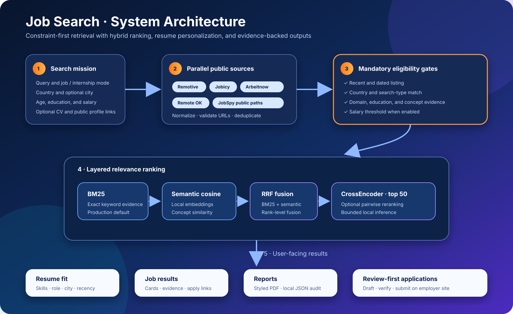

# Job Search — Technical Report

[← Clone and run the project](README.md#tab-1--clone--run) · [Documentation index](docs/document.md)

### 1. Project objective

Job Search is an end-to-end applied information-retrieval system. It addresses five practical problems:

1. Aggregate recent openings from inconsistent public sources.
2. Prevent irrelevant, stale, wrong-country, wrong-search-type, and below-threshold listings from leaking into results.
3. Match concepts even when a listing does not repeat the exact user phrase.
4. Personalize eligible results using resume evidence without persisting raw applicant data.
5. Present understandable evidence, reports, and application drafts without claiming that an application was submitted.

The project is a substantial engineering and portfolio system. Its synthetic benchmark provides a repeatable regression check for ranking changes; production behavior also depends on the availability and quality of live source data.

### 2. System architecture



The architecture keeps eligibility rules separate from relevance models. Live
sources feed a normalized job schema, mandatory gates establish the eligible
set, and layered rankers organize only that set before the dashboards generate
evidence, reports, and review-first application materials.

Hard constraints are evaluated before optional neural ranking. A high model score cannot admit an old, wrong-country, wrong-search-type, or otherwise ineligible listing.

### 3. Live retrieval and normalization

Bounded parallel source agents retrieve listings from Remotive, Jobicy, Arbeitnow, Remote OK, and public LinkedIn/Indeed/Google paths through JobSpy. Glassdoor is exposed as a targeted search link because its public scraping route is unreliable. Each source is converted to a common schema containing title, company, location, description, publication date, salary evidence, source URL, and original application URL.

Normalization includes HTML cleanup, date handling, salary normalization, canonical identifiers, URL validation, and cross-source deduplication. The original source remains authoritative.

A constrained RL scheduler runs source agents in bounded waves by default and
stop launching additional sources once verified yield is sufficient. Its action
space cannot modify job eligibility or ranking, and an untrained policy uses a
deterministic cold-start controller. Runtime decisions and source timings are
recorded in the local audit. See the [scheduler design](docs/rl-scheduler.md).

#### Adaptive scheduler performance analysis

The scheduler benchmark uses deterministic local source functions so network
rate limits, changing listings, and job-board availability do not distort the
orchestration measurement. Five sources have fixed 30–80 ms response delays.
The all-source baseline starts all five concurrently; the adaptive scheduler
starts two, evaluates verified yield at the wave boundary, and launches later
sources only when necessary. Each scenario was run 10 times.

| Scenario and mode | p50 latency | p95 latency | Mean source calls | Mean jobs returned | Mean agents skipped |
|---|---:|---:|---:|---:|---:|
| Early yield sufficient · all sources | 0.0853 s | 0.0863 s | 5 | 24 | 0 |
| Early yield sufficient · RL scheduler | **0.0457 s** | **0.0458 s** | **2** | 15 | **3** |
| Early yield insufficient · all sources | **0.0859 s** | **0.0863 s** | 5 | 15 | 0 |
| Early yield insufficient · RL scheduler | 0.1940 s | 0.1963 s | 5 | 15 | 0 |

When the initial wave reached the 15-job target, adaptive scheduling reduced
p50 latency by **46.42%** and source calls by **60%**, while returning the full
configured target. When the initial sources returned no eligible jobs, the
scheduler still eventually calls every source (fixed source ordering cannot
avoid that for a genuinely sparse query) and p50 latency increased by
**125.84%**.

That penalty used to be **190.8%**. The scheduler originally launched every
expansion source one at a time — a full stop-and-decide cycle between each —
so a 5-source sparse query paid for 5 sequential round trips. The runner now
fills the configured parallel ceiling (`JOBSEARCH_RL_MAX_PARALLEL`, default 2)
on every expansion wave instead of adding one source at a time, so the same
5-source case now pays for 3 waves (2 + 2 + 1) instead of 5. The major-site
adapter — the broadest-coverage source for specialized roles — is also placed
into the initial wave instead of launching last, so it is no longer the final,
most expensive call in a sparse expansion. Remaining sparse-query cost is
structural: a query with no early yield must eventually try every configured
source, and full parallel dispatch remains available by disabling the
scheduler for latency-sensitive sparse queries. The next optimization is to
learn source ordering and expected yield from historical per-query traces so
low-value sources can be skipped instead of merely reordered; the
[paired replay evaluator](docs/rl-scheduler.md#paired-recording-and-replay)
now exists specifically to validate a change like that against recorded
traffic, with an explicit promotion gate, before it becomes the default.

The recorded result is stored in
[`benchmarks/rl_scheduler_v1_results.json`](benchmarks/rl_scheduler_v1_results.json)
and can be reproduced with:

```bash
PYTHONPATH=. .venv/bin/python benchmarks/benchmark_rl_scheduler.py \
  --trials 10 --output benchmarks/rl_scheduler_v1_results.json
```

#### Real paired replay

The exact query `computer vision robotics research engineer` was captured once
with all five live sources using United States, PhD, a 10-day maximum age, and a
100,000 minimum salary. Both dispatch policies were then evaluated against the
identical frozen source batches and recorded source timings.

| Metric | Full parallel | Default adaptive | Change |
|---|---:|---:|---:|
| Modeled latency | 96.4108 s | 96.4108 s | 0.0% |
| Source calls | 5 | **2** | **−60.0%** |
| Fetched listings | 302 | **164** | **−45.7%** |
| Verified jobs | 12 | 12 | 0.0% |
| Unique companies | 10 | 10 | 0.0% |
| Ranked job IDs | 12 | 12 | Identical |

The adaptive controller preserved every final result in this scenario while
avoiding three low-value source calls. It did not improve latency because the
major-site adapter was the slowest source and was required by both policies.
This is evidence of call reduction and result preservation for one recorded
query—not proof that a trained RL policy improves general performance.

The promotion gate remains **failed** because no independent relevance labels
or trained Q-policy are available, latency did not improve, and one scenario is
insufficient for a default-policy decision. The committed aggregate is stored
in [`benchmarks/rl_live_replay_v1_summary.json`](benchmarks/rl_live_replay_v1_summary.json).
Raw replay files stay local and are ignored by Git because they contain copied
public job descriptions.

Record and compare another scenario with:

```bash
./run.sh cli --country "United States" --no-rl-scheduler \
  --record-scenario benchmarks/replays/scenario.json "QUERY"

PYTHONPATH=. .venv/bin/python -m rl_scheduler.evaluate \
  benchmarks/replays/scenario.json \
  --label-template benchmarks/replays/labels.json \
  --output benchmarks/replays/evaluation.json
```

### 4. Constraint-preserving filtering

The inexpensive mandatory gates run before embeddings and reranking:

- valid and sufficiently recent publication date;
- mandatory country match;
- Jobs versus Internships evidence;
- requested education evidence;
- disclosed annualized salary threshold when the threshold is nonzero;
- concept relevance across the title and description;
- domain evidence for specialized queries such as robotics;
- unsafe or malformed listing rejection.

City is deliberately a soft preference. Robotics is concept-aware rather than literal: terms such as manipulation, SLAM, localization, motion planning, autonomy, perception, ROS, and robot learning can establish domain evidence.

### 5. BM25 keyword retrieval

BM25 is the production default. The document representation gives additional weight to titles and tags while retaining description, company, and location evidence. Its core score is:

```text
BM25(q, d) = Σ IDF(qᵢ) · [f(qᵢ,d) · (k₁ + 1)]
                         ─────────────────────────────
                         f(qᵢ,d) + k₁ · (1 - b + b|d|/avgdl)
```

This method is strong for exact technical evidence such as `ROS 2`, `CPA`, `C++`, certifications, degrees, and specialized titles. The implementation uses `rank-bm25`, stable tokenization, fourfold title weighting, and deterministic fallback when the dependency is unavailable.

### 6. Semantic embeddings and cosine similarity

Optional semantic mode uses `sentence-transformers/all-MiniLM-L6-v2`. It encodes the query and controlled job text locally. For query vector **q** and document vector **d**:

```text
cos(q, d) = (q · d) / (||q||₂ ||d||₂)
```

Vectors are normalized before the dot product. Duplicate job text is collapsed by SHA-256 content hash during each call so identical text is encoded once. Embeddings remain in memory and are discarded after the process; the project does not require Pinecone, ChromaDB, Weaviate, Milvus, Redis, SQLite, or another persistent vector store.

### 7. Reciprocal Rank Fusion

Hybrid mode combines BM25 and semantic rankings without averaging incompatible raw scores:

```text
RRF(d) = Σᵣ 1 / (k + rankᵣ(d)),    k = 60
```

RRF rewards documents that rank well in either constituent list and is stable when BM25 and cosine scores use different numerical scales. If semantic retrieval fails, the pipeline retains BM25; if both optional rankers fail, it returns to deterministic ordering.

### 8. CrossEncoder reranking

Experimental rerank mode uses `cross-encoder/ms-marco-MiniLM-L-6-v2`. Unlike independent embeddings, a CrossEncoder reads each query–job pair jointly and produces a relevance score. To control latency and memory, it processes at most the top **50** hybrid candidates. Failure preserves the best available retrieval order.

### 9. Resume intelligence and personalization

The project taxonomy covers **356 skills, 21 categories, and 32 domains**, including—but not limited to—AI and robotics. Resume agents extract structured evidence from PDF, DOCX, TXT, or Markdown CVs. Public GitHub evidence can be analyzed; public portfolio analysis is opt-in. LinkedIn URLs are recognized but not scraped.

Only derived evidence enters ranking. Raw CV text, fetched portfolio text, and applicant contact fields are excluded from reports and audits. Eligible jobs can be ordered using:

```text
personalized score = 0.65(resume fit)
                   + 0.25(query relevance)
                   + 0.10(city preference)
```

Recency provides deterministic tie-breaking. Personalization cannot override mandatory gates.

### 10. Evidence-validated Gemma summaries

Gemma through Ollama is optional and disabled by default. It receives the search query, job title, company, and bounded source description for only the top displayed listings. It returns structured JSON containing:

- role overview;
- overview evidence;
- experience statements with evidence;
- requirements with evidence.

Every evidence excerpt must occur in the source description. Invalid JSON, missing support, timeout, unavailable Ollama, or unsupported claims cause a per-job deterministic fallback. Defaults are:

- model: `gemma3:4b`;
- maximum output: 900 tokens per listing;
- maximum summarized jobs: 10, configurable up to 30;
- concurrency: at most 2 generations.

Gemma does not control country, age, salary, search type, eligibility, ranking, or application status.

### 11. Ranking benchmark and numerical results

The versioned benchmark is stored in `benchmarks/ranking_v1.json`. It contains synthetic, de-identified query–candidate judgments and hard-rejection cases. `tests/test_ranking_benchmark.py` verifies that forbidden listings never enter ranked results and evaluates:

```text
Precision@k = relevant retrieved in top k / retrieved in top k
Recall@k    = relevant retrieved in top k / all labeled relevant

DCG@k  = Σᵢ₌₁ᵏ (2^relᵢ - 1) / log₂(i + 1)
NDCG@k = DCG@k / IDCG@k
```

| Ranking configuration | Precision@5 | Precision@10 | Recall@50 | NDCG@10 | Status |
|---|---:|---:|---:|---:|---|
| Deterministic recency baseline | 0.722222 | 0.722222 | 1.000000 | 0.706427 | Fallback |
| Semantic cosine | 0.722222 | 0.722222 | 1.000000 | 0.895588 | Opt-in |
| BM25 | 0.722222 | 0.722222 | 1.000000 | 0.933686 | Default |
| Hybrid BM25 + semantic RRF | 0.722222 | 0.722222 | 1.000000 | **0.947923** | Best benchmark quality; opt-in |
| Hybrid + CrossEncoder | 0.722222 | 0.722222 | 1.000000 | 0.933686 | Experimental |

Hybrid RRF improves NDCG@10 from **0.706427 to 0.947923**, an absolute gain of **0.241496** and a relative gain of approximately **34.19%** on benchmark v1. Recall@50 remains 1.0 and the hard-gate tests reject all labeled forbidden candidates.

The benchmark cases contain fewer than five eligible jobs in some queries, so Precision@5 and Precision@10 use the available result window and cannot yet demonstrate improvement. The CrossEncoder cold benchmark run was approximately **14.3 seconds** and did not beat hybrid RRF, so it remains experimental.

### 12. Application preparation and company staff discovery

The application assistant creates an editable cover-letter draft, reusable profile answers, CV-to-job evidence, and a review queue. It never claims submission, bypasses authentication, solves CAPTCHA, accepts consent, or answers unknown screening questions automatically. The final action opens the original employer site.

Public company staff discovery is bounded to verified official pages. It can display named technical staff, roles, technical areas, official biographies, careers pages, and explicitly published company recruiting addresses. A person is highlighted as a hiring manager only when an official source explicitly identifies that role. Personal Gmail addresses, guessed emails, phone numbers, LinkedIn scraping, and private contact data are excluded.

### 13. Reports, privacy, and failure behavior

Each search can produce responsive job cards, a styled PDF, original application links, and a local JSON audit. Generated files live in `reports/` and are ignored by Git.

Privacy boundaries include:

- no paid cloud LLM API requirement;
- no persistence of raw CV or portfolio page text in reports;
- no applicant contact data in generated search reports;
- no model authority over hard constraints;
- no automatic application submission;
- bounded URL fetching with scheme, address, port, timeout, content-type, redirect, and response-size controls;
- deterministic degradation when optional models or sources fail.

### 14. Testing and continuous integration

The current offline suite contains **74 passing tests** covering filtering, internship classification, salary behavior, BM25, semantic scoring, RRF, CrossEncoder limits, ranking metrics, Gemma evidence validation, RL scheduling, replay evaluation, privacy filtering, promotion gates, Q-learning, JSON parsing, documentation links, resume behavior, and fallbacks.

GitHub Actions runs on pushes and pull requests with read-only repository permissions. CI:

1. installs base and development dependencies on Python 3.11;
2. runs `pip check`;
3. compiles Python sources;
4. runs pytest and documentation-link validation;
5. checks whitespace.

CI intentionally avoids downloading Ollama and optional neural weights; model interfaces are tested with deterministic fakes.

### 15. Technology map

| Area | Implementation |
|---|---|
| Language | Python |
| Interfaces | Gradio, Streamlit, CLI |
| Job retrieval | Public feeds and JobSpy adapters |
| Keyword ranking | `rank-bm25` |
| Semantic ranking | Sentence Transformers + NumPy cosine similarity |
| Fusion | Project-owned Reciprocal Rank Fusion |
| Final reranking | Local Sentence Transformers CrossEncoder |
| Local generation | Gemma through Ollama |
| Resume files | pypdf, python-docx, plain text/Markdown |
| Reports | ReportLab PDF + JSON audit |
| Tests | pytest |
| Automation | GitHub Actions |
| Concurrency | Bounded Python thread pools |
| Persistence | Generated report artifacts only; no vector database or resume cache |

### 16. Operational limitations

- Live job sources can change markup, rate-limit requests, or return incomplete data.
- Salary and publication dates are shown only when reliable source evidence exists.
- Public web retrieval cannot guarantee complete coverage of every job board.
- Resume-fit scores estimate textual evidence overlap and are not hiring predictions.
- The synthetic benchmark is designed for repeatable regression testing and does not represent every occupation, location, or live source condition.
- Ranking quality depends on the completeness and accuracy of the text supplied by each job source.
- Optional neural ranking adds local model download, memory, and latency costs, so BM25 remains the lightweight default.

The system is designed as a practical open-source job-search and application-preparation product. Ranking scores help organize source evidence; they do not evaluate a person's employability or replace applicant and employer judgment.

### 17. Repository guide

| Path | Responsibility |
|---|---|
| `core/jobs.py` | Source normalization, constraints, relevance, ranking orchestration, and report text |
| `core/bm25_ranker.py` | Keyword retrieval |
| `core/semantic_ranker.py` | Local embeddings and cosine similarity |
| `core/rrf_ranker.py` | Reciprocal Rank Fusion |
| `core/cross_encoder_ranker.py` | Bounded pairwise reranking |
| `core/gemma_summaries.py` | Evidence-validated optional summaries |
| `core/resume_intelligence.py` | Resume and safe public-link evidence analysis |
| `core/applications.py` | CV extraction and review-first drafts |
| `agents/coordinator.py` | Search orchestration and artifact generation |
| `app_gradio.py` | Primary Gradio dashboard |
| `app_streamlit.py` | Streamlit dashboard |
| `benchmarks/ranking_v1.json` | Versioned ranking judgments |
| `tests/` | Offline regression and ranking evaluation suite |
| `.github/workflows/ci.yml` | Continuous integration |

For focused operational documentation, open the [documentation index](docs/document.md).

[← Clone and run the project](README.md#tab-1--clone--run) · [README](README.md)

---

## Responsible-use notice

Job Search assists discovery and preparation. Employers and original job pages remain authoritative. Users must verify every generated statement, eligibility answer, salary value, and application field before submission. The software must not be used to collect private contact information, bypass access controls, misrepresent qualifications, or submit applications without informed human review.
